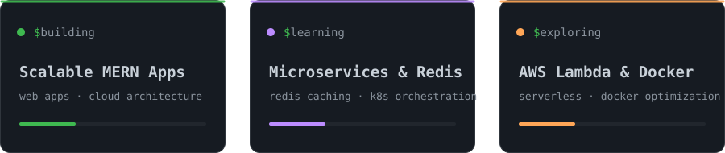
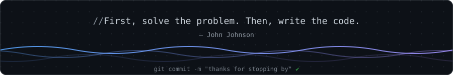

<div align="center">



<p>
  <a href="https://www.linkedin.com/in/ism-guarte-9a1055238/"></a>
  <a href="https://twitter.com/ism_guarte"></a>
  <a href="https://instagram.com/hi_im_ism"></a>
</p>

</div>

## `~/about`

```typescript
const ism = {
  location: "Philippines",
  role: "Full Stack Developer",
  focus: ["Scalable Web Apps", "MERN Stack", "Cloud Architecture"],
  learning: ["Microservices", "Redis Caching", "K8s Orchestration"],
  exploring: ["AWS Lambda", "Docker Optimization", "Serverless"],
  askMeAbout: ["Web Dev", "JavaScript", "TypeScript", "React", "Node.js"],
  funFact: "I debug with console.log() and I'm not ashamed!",
  philosophy: "Code is poetry; bugs are just unexpected features",
};
```

## `~/stack`

<div align="center">
  
</div>

## `~/now`

<div align="center">
  
</div>

<br />

<div align="center">
  
</div>
